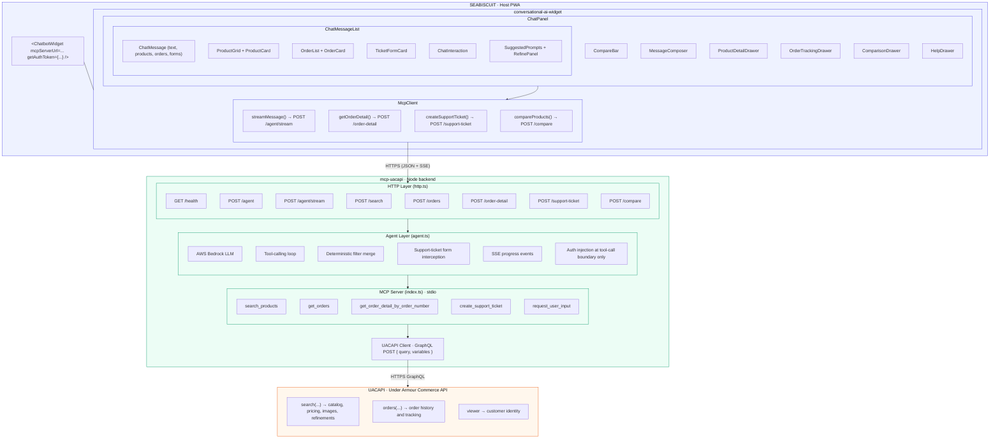

# System Architecture

End-to-end view of the conversational AI stack: the host PWA embeds the widget,
which talks to the `mcp-uacapi` Node backend over HTTPS (JSON + SSE); the backend
runs the agent/MCP tools and calls UACAPI over GraphQL.

## Layers

| Layer | Module | Responsibility |
|-------|--------|----------------|
| Host PWA | SEABISCUIT | Mounts `<ChatbotWidget>`, supplies `mcpServerUrl` + `getAuthToken` |
| Widget | `conversational-ai-widget` | ChatPanel UI, drawers, and `McpClient` HTTP calls |
| Backend | `mcp-uacapi` | HTTP layer, Bedrock agent + tool loop, MCP server, UACAPI client |
| Commerce API | UACAPI | `search`, `orders`, `viewer` over GraphQL |

## Request flow

1. Host renders the widget with the MCP server URL and an auth-token getter.
2. `McpClient` calls the backend over HTTPS; `/agent/stream` streams SSE progress.
3. The agent runs the Bedrock tool-calling loop, injecting auth only at the
   tool-call boundary, and invokes MCP tools over stdio.
4. MCP tools call the UACAPI client, which issues GraphQL queries.
5. Results flow back up: UACAPI → tools → agent → SSE/JSON → widget render.
